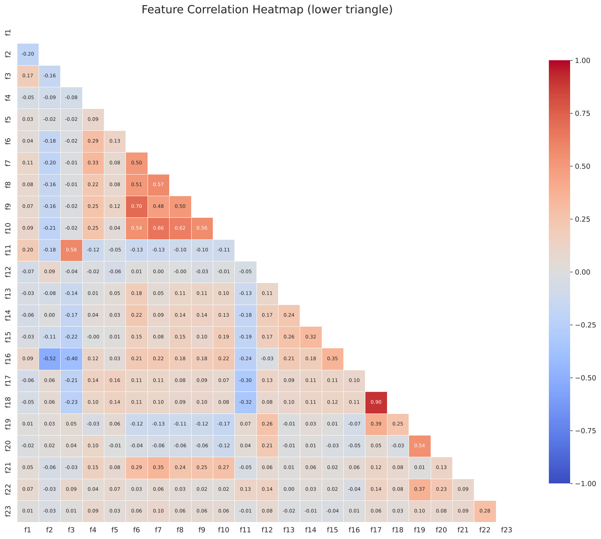

# American Express Campus Challenge 2026 – Member Profitability

Identify the **top 20% most profitable cardmembers** out of 500,000, using 23 anonymised behavioural features.

Instead of training a black-box model, this project builds an **explicit profit-and-loss statement for every member**: the revenue the card earns from them minus the cost of serving them. Every term maps to a real lever in a card business, so each prediction can be explained line by line.

**Final leaderboard score: 0.883** (economic baseline: 0.823)

---

## Results

**Metric: Top-20% identification accuracy.** Of the members who are truly in the top 20% by profitability, the share that also appear in the model's predicted top 20%. Only the *ranking* matters, not the absolute profit values.

### Leaderboard log

Scores as recorded during the competition:

| # | Experiment | Score |
|---|---|---|
| 1 | Economic baseline | 0.823 |
| 2 | Use `f5` (Total Spend) instead of summing f6–f10 | 0.388 |
| 3 | Spend (discount) coefficient → 0.040 | 0.832 |
| 4 | Spend (discount) coefficient → 0.070 | 0.767 |
| 5 | Remove f20 (active charge cards) | 0.847 |
| 6 | Rewards cost coefficient → 0.012 | 0.826 |
| 7 | Remove rewards cost entirely | 0.819 |
| 8 | Use f21 (points redeemed) instead of f4 (points balance) | 0.756 |
| 9 | Raise risk-adjusted interest | 0.876 |
| 10 | **Final model** | **0.883** |

Risk-adjusted interest settings tried (interest rate, loss weight):

| Interest rate | Loss weight | Score |
|---|---|---|
| 0.18 | 0.9 | 0.847 |
| 0.30 | 3.0 | 0.876 |
| **0.42** | **5.1** | **0.883** |

### Reconciling the log with the code

The log was kept informally by several team members, so it was checked afterwards against a surviving submission file (scored 0.875) using [`compare_submission.py`](compare_submission.py):

| Model version | Share of the 0.875 file's top 20% reproduced |
|---|---|
| Code in this repo (final model) | 98.1% |
| Code in this repo **+ 0.001 × f4 points-balance cost** | **99.7%** |

What this establishes:

- **The 0.875 submission = the final interest settings (0.42 / 5.1) plus a cost of 0.001 per point of unredeemed rewards balance (f4).** Alternatives such as 0.30 / 3.0 reproduce at most ~95.6%.
- **The discount rate in that submission was 0.037, not 0.040.** The two differ on only 1.6% of the top-20% list, so this choice has little effect.
- **The most likely last step to 0.883 was dropping the f4 balance cost**, which is the code in this repo. This is inferred, not confirmed. Running `compare_submission.py` on the 0.883 submission file would confirm it.

### What the experiments show

- **Risk-adjusted interest is the biggest lever.** Tuning interest revenue and expected credit loss together added more than any other change.
- **Spend matters, but only within a realistic range.** A discount rate near 4% works; 7% overweights big spenders and hurts the ranking.
- **The rewards cost was already about right.** Doubling it (0.826) and removing it (0.819) both scored lower, and basing it on redemptions (f21) was much worse (0.756).
- **f5 is broken.** Swapping it in collapsed the score to 0.388, confirming the EDA finding below.

---

## The model in one equation

```
Profit = Income − Expenses

Income   = merchant discount on spend
         + interest on revolving balance
         + supplementary card fees

Expenses = rewards points earned
         + travel / lifestyle benefits used
         + expected credit loss
         + collection & retention costs
```

Members are ranked by profit and the top 20% are predicted as most profitable.

### How each term maps to the data

| P&L line | Formula | Features used |
|---|---|---|
| **Merchant discount revenue** | 0.037 × (sum of category spend) | f6 Airlines, f7 Other, f8 Entertainment, f9 Lodging, f10 Dining |
| **Interest revenue** | 0.42 × revolving balance | f1 Avg Revolve Balance |
| **Supplementary card fees** | 175 × no. of supp. accounts | f19 Supplementary Accounts |
| **Rewards cost** | 0.006 × points earned (5× on airlines + lodging, 1× elsewhere) | f6, f9 (5×); f7, f8, f10 (1×) |
| **Lounge cost** | 35 × lounge visits | f13 Lounge Access Count |
| **Airline credits** | amount used, at face value | f14 Credits Used in Airlines |
| **Cab benefits** | 15 × uses | f15 Cab Benefits Usage |
| **Entertainment credits** | amount used, at face value | f16 Entertainment Credit Used |
| **Expected credit loss** | 5.1 × risk score × revolving balance | f11 Avg Risk Score, f1 |
| **Collections cost** | 400 × collection-related calls | f3 Cancellation Calls due to Collection |
| **Retention cost** | 30 × cancellation calls | f2 Cancellation Calls |

Missing values are filled with each feature's **median**, which is robust to the heavy right tails in the spend and balance features.

### Parameter choices

These are **estimated economic weights**, not published Amex figures. Each starts from a business-plausible value and was refined through the leaderboard experiments above. The aim is a correct *ranking* of members, not exact profit in rupees or dollars.

| Parameter | Value | How it was set |
|---|---|---|
| `discount_rate` | 0.037 | Estimate of merchant discount revenue per unit of spend; 0.040 and 0.070 also tested |
| `interest_margin` | 0.42 | Tuned jointly with the loss weight (0.18 → 0.30 → 0.42). Coincides with the Amex India finance charge of 3.5%/month = 42% p.a. (gross; ignores cost of funds) |
| `supp_fee` | 175 | Estimated annual fee per supplementary card |
| `reward_cost_per_pt` | 0.006 | Estimated cost of one reward point; 0.012 and 0 also tested |
| `lounge_cost` | 35 | Estimated cost per lounge visit |
| f14, f16 credits | 1 | Already monetary amounts, so taken at face value |
| `cab_cost` | 15 | Estimated cost per cab benefit use |
| `lgd_x_pd_weight` | 5.1 | Expected-loss weight (see below). **Empirically tuned** |
| `collection_cost` | 400 | Estimated servicing cost of a collection-related call |
| `cancel_cost` | 30 | Estimated servicing cost of a cancellation call |
| `points_balance_cost` | 0 | Cost per point of unredeemed balance (f4). Was 0.001 in the 0.875 submission |

### The expected-loss weight (5.1)

```
Expected loss penalty = 5.1 × f11 (risk score) × f1 (revolving balance)
```

This follows the standard credit-risk idea **Expected Loss = PD × LGD × EAD**: f11 stands in for probability of default, f1 for exposure, and 5.1 absorbs loss-given-default plus the scaling of the risk score. It was not taken from a financial statement; it was raised step by step together with the interest rate while watching the leaderboard.

Raising both together means revolving customers are credited for the interest they pay *and* penalised for their default risk, so the model separates profitable revolvers from risky ones.

---

## Key EDA findings (`edaFile.py`)

1. **Top-1% capping.** For f1, f6 and f7 the 99th percentile equals the maximum (e.g. f1 is capped at 17,968), so the data provider has clipped extreme values. Because the metric is rank-based, this mostly affects ties at the very top.
2. **f5 "Total Spend" does not add up.** It correlates only 0.10 with the sum of its own components f6–f10, and its median (2,166) is about 12× smaller than theirs (26,964). It is treated as unreliable, and total spend is rebuilt by **summing f6–f10**.
3. **Correlated features group into economic levers** (|r| ≥ 0.5):
   - **Spend:** f6–f10 all correlate 0.48–0.70 with each other (airlines ↔ lodging is strongest at 0.70)
   - **Credit risk:** f11 risk score ↔ f3 collection-related calls, 0.58
   - **Credit lines:** f17 ↔ f18, 0.90 (near-duplicates)
   - **Account footprint:** f19 supplementary accounts ↔ f20 active charge cards, 0.54
   - **Retention:** f2 cancellation calls ↔ f16 entertainment credit used, −0.52; members who use their benefits call to cancel less
4. **Risk direction.** f11 correlates positively with f3, confirming that a **higher f11 means riskier**, so it enters as a cost.



---

## Features not used, and why

| Feature | Why it's excluded |
|---|---|
| f4 Rewards Points Balance | A balance cost (0.001 per point) was used in the 0.875 submission and dropped in the final model |
| f21 Points Redeemed | Using it in place of f4 dropped the score to 0.756 |
| f5 Total Spend | Unreliable; see EDA finding 2 (scored 0.388) |
| f12 Logins, f22 Emails Opened, f23 Emails Clicked | Engagement signals; no direct revenue or cost in a 12-month P&L (f23 is also 88% missing) |
| f17 Total Lend Line, f18 Consumer Lend Line | Credit limits; exposure is captured by the actual revolving balance (f1). Both are ~60% missing |
| f20 Active Charge Cards | Included in the baseline; removing it improved the score (0.832 → 0.847) |

---

## Feature dictionary

| Feature | Description |
|---|---|
| f1 | Average Revolve Balance in last 12m |
| f2 | Cancellation Calls in last 12m |
| f3 | Cancellation Calls due to Collection |
| f4 | Rewards Points Balance |
| f5 | Total Spend in last 12m |
| f6 | Airlines Spend in 12m |
| f7 | Other Spend in 12m |
| f8 | Entertainment Spend in 12m |
| f9 | Lodging Spend in 12m |
| f10 | Dining Spend in 12m |
| f11 | Average Risk Score in 12m |
| f12 | Login Counts to website |
| f13 | Lounge Access Count |
| f14 | Credits used in airlines |
| f15 | Cab benefits usage |
| f16 | Entertainment Credit Used Amount |
| f17 | Total Lend Line Amount |
| f18 | Total Consumer Lend Line Amount |
| f19 | Number of Supplementary Accounts |
| f20 | Count of Active Charge Cards |
| f21 | Rewards point redeemed in 12months |
| f22 | Emails Open in Last 6 months |
| f23 | Emails Clicked in Last 6 months |

---

## How to run

The competition dataset (500,000 rows) is not included. Place it at:

```
data/campus_challenge_r1_data.csv
```

Then:

```bash
pip install -r requirements.txt

python edaFile.py                  # prints EDA checks
python charts.py                   # saves figures to figures/
python profitability_framework.py  # writes predictions.csv (columns: ID, Prediction)

# check which model version produced a past submission
python compare_submission.py path/to/submission.xlsx
python compare_submission.py path/to/submission.xlsx --points-balance-cost 0.001
```

## Repo structure

```
├── edaFile.py                  # data-quality and correlation checks
├── charts.py                   # correlation visualisations → figures/
├── profitability_framework.py  # P&L scoring model → predictions.csv
├── compare_submission.py       # match a past submission to a model version
├── figures/                    # generated charts
├── requirements.txt
└── README.md
```

---

## Limitations and next steps

- **Leaderboard overfitting risk.** Parameters were tuned over ~10 submissions to the same public leaderboard, and the last step gained under 0.01. Some of that gain may not carry over to unseen data; a held-out validation split would be the next safeguard.
- **Weights are estimates, not sourced costs.** A sensitivity analysis (±20% on each) would show which assumptions actually drive the ranking.
- **Annual fees are not modelled.** f20 hurt as a direct term, but a proper annual-fee revenue line by card type could still help.
- **Interest is gross, not net.** Subtracting a cost-of-funds rate would give a truer net interest margin.
- **Benchmark against ML.** A gradient-boosting model on the same features would show how much accuracy, if any, the interpretable approach gives up.
